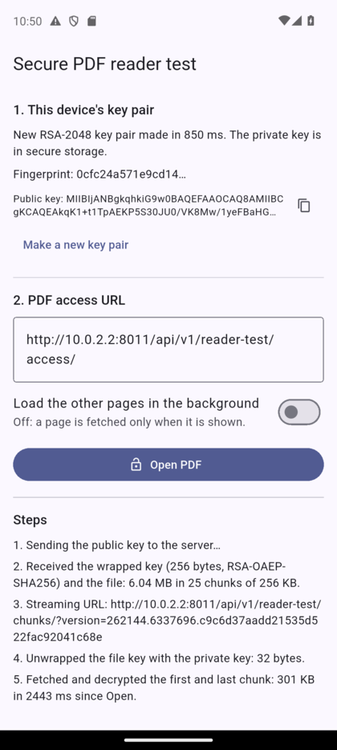
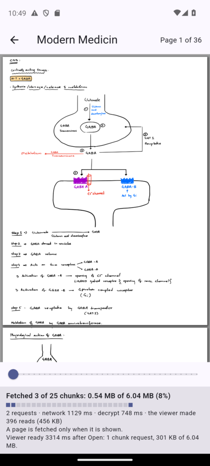
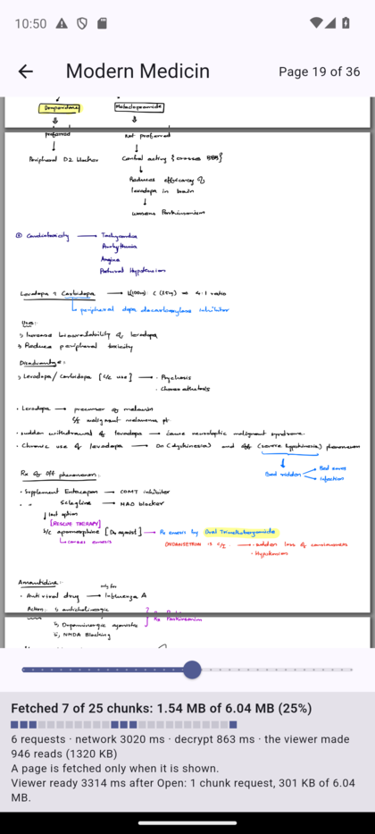

# Secure PDF reader test

A small Flutter app that proves the encrypted reading flow from end to end:

1. It makes an RSA key pair on the phone and keeps the private key in secure storage.
2. It sends the public key to the backend.
3. It gets back the PDF's key, wrapped so that only this phone can use it, and a streaming URL.
4. It unwraps the key with the private key.
5. It shows the PDF with **pdfrx**, fetching and decrypting only the chunks the viewer asks for.

It is a test app. It talks to a temporary test endpoint that needs no login and only ever sends **book 1039**. It is not part of the real mobile app.

| First screen | Page 1 open: 3 of 25 chunks | After a jump to page 19 |
|---|---|---|
|  |  |  |

## Run it

**1. Backend**

- `backend/.env` needs `READER_TEST_ENDPOINT=True`. It is already there on this PC.
- Start the backend the usual way (`v3 Backend API (:8000)`). If it was already running, restart it once so it reads the new line.
- The endpoint answers only while `DEBUG` is on. On a real server it is always a 404.

**2. App**

```
cd secure_pdf_reader_test
fvm flutter pub get
fvm flutter run
```

It uses Flutter 3.41.6, the same version as the main app (`.fvmrc` pins it).

Run it from a terminal with `fvm`, as above. An editor's Run button may use another Flutter:

- **"requires SDK version ^3.11.4, version solving failed"** means an older Flutter was used. On this PC, VS Code is set to `C:\flutter` (Flutter 3.27, Dart 3.6).
- If the editor then offers to "enable Android for this project", say no. With an old Flutter that adds `android/build.gradle`, `android/settings.gradle` and `android/app/build.gradle`, and the build then fails with "Android Gradle Plugin version 8.1.0 is lower than Flutter's minimum". Delete those three files; the real ones end in `.kts`.

**3. Paste the access URL and press "Open PDF"**

| Where the app runs | URL |
|---|---|
| Android emulator on this PC | `http://10.0.2.2:8000/api/v1/reader-test/access/` (filled in already) |
| A phone on a USB cable | `http://127.0.0.1:8000/api/v1/reader-test/access/`, after `adb reverse tcp:8000 tcp:8000`. Run that command again each time the phone is plugged in |
| A phone on the same Wi-Fi | `http://<this PC's IP address>:8000/api/v1/reader-test/access/`, with the backend started as `manage.py runserver 0.0.0.0:8000` |
| Through a dev tunnel | `https://<tunnel address>/api/v1/reader-test/access/` |

## What you see

**First screen**

- The key pair: made on the first start, loaded from secure storage after that. "Make a new key pair" replaces it.
- The access URL field.
- A switch, "Load the other pages in the background":
  - **Off** (default): a page is fetched only when it is shown.
  - **On**: what pdfrx does by default. It shows page 1, then measures every other page, which fetches the whole file within seconds.
- The steps, as they happen: public key sent, wrapped key received, key unwrapped, first chunks fetched.

**Reader screen**

- The PDF, a page slider for jumping, and the page number.
- "Fetched N of M chunks", with one small square per chunk. A square fills in when that chunk has been fetched.
- Requests sent, time spent on the network and on decryption, and how many reads the viewer made.
- "Viewer ready … after Open": how long and how much data it took before the first page could show.

## The temporary test endpoint

Code: `backend/notespedia/catalog/views_reader_test.py`. Tests: `backend/notespedia/catalog/tests/test_reader_test_endpoint.py`.

| Call | What it does |
|---|---|
| `POST /api/v1/reader-test/access/` | Body `{"public_key": "<Base64 DER>", "algorithm": "RSA-OAEP-SHA256"}`. Answers the file's key wrapped for that public key, the file's layout, and `stream_url` |
| `GET <stream_url>&chunks=0-1,22` | The chunks asked for, still encrypted |

Example answer of `access/`:

```json
{
  "book_id": 1039,
  "name": "Modern Medicin",
  "pages": 20,
  "version": "262144.6337696.c9c6d37aadd21535d522fac92041c68e",
  "file_size": 6337268,
  "chunk_size": 262144,
  "tag_size": 16,
  "total_chunks": 25,
  "header": "<Base64, 28 bytes>",
  "cipher": "AES-256-GCM",
  "wrapped_key": "<Base64, 256 bytes>",
  "key_algorithm": "RSA-OAEP-SHA256",
  "stream_url": "/api/v1/reader-test/chunks/?version=262144.6337696.c9c6d37aadd21535d522fac92041c68e"
}
```

- `stream_url` is relative. The app resolves it against the URL it called.
- The answers have the same fields as the real `mobile/books/<id>/access/` and `chunks/`, so code that works here works there. The real calls differ in two ways: they need a login, and the public key is registered once with `devices/reader-key/` instead of being sent with each `access`.
- The key sent is the key of this one file, wrapped. The book's own key never leaves the server.
- **No login.** While the switch is on, anyone who can reach the server can read book 1039. Nothing in a request can name another book.

**Remove it after testing:** delete `READER_TEST_ENDPOINT` from `backend/.env`. To take it out of the code, delete `catalog/views_reader_test.py`, `catalog/urls_reader_test.py`, the test file, the `reader-test` line in `notespedia/urls.py` and the setting in `settings.py`.

## What was measured

Book 1039 is a 6.04 MB PDF of 36 pages, stored as 25 chunks of 256 KB. (The book's record says 20 pages; the PDF has 36.)

On the Pixel 8 emulator (Android 14), debug build, backend on this PC, file in S3:

| Step | Data fetched | Requests |
|---|---|---|
| Viewer ready, page 1 can show | 301 KB of 6.04 MB (the first and last chunk) | 1 |
| Pages 1 and 2 on screen | 0.54 MB (8%) | 2 |
| After a jump to page 19 | 0.79 to 1.54 MB (13 to 25%) | 3 to 6 |
| Switch on: every page loaded in the background | 6.04 MB (100%) | 24 |

- The viewer was ready 1.7 to 7.6 seconds after "Open PDF", mostly 3 to 5. The first open after the emulator starts is the slowest: it also loads the PDF engine.
- Making the key pair took 0.85 seconds.

On a real phone (OnePlus CPH2467, Android 15), debug build, backend reached over `adb reverse`, one open:

- The amounts were the same: viewer ready after 1 chunk request (301 KB), and 0.54 MB (8%) in 2 requests with pages 1 and 2 on screen.
- The viewer was ready 3.1 seconds after "Open PDF". Making the key pair took 0.66 seconds.

Both are debug builds, which are slow. A release build will be faster; the amounts of data will not change.

## What the test showed, for the real app

1. **The flow works** with pdfrx 2.4.7 on Flutter 3.41.6, the main app's Flutter version.
2. **Fetching only the pages that are viewed** needs a trick on pdfrx 2.4: put its background pass off with `trailingPageLoadingDelay` (see `reader_page.dart`). pdfrx 2.5 and later has a proper setting for it, `loadPageDimensionsOnDemand`, but needs Flutter 3.47.
3. **A failed read can crash the app.** After one page fails to load, pdfrx 2.4 carries on with the next pages, and PDFium can then abort the whole app. This happened when the reader was closed while pages were loading. The rules that fixed it are in `chunk_source.dart`:
   - Wait out network trouble: repeat the request for as long as the viewer is open, and show "Waiting for the network".
   - When the screen closes, keep answering reads until pdfrx reports that it has closed the document (`onDispose`). Drop the chunks and the key only then.
   - When the server refuses (the file changed, access ended), stop for good, send no further request, and take the viewer off the screen.
4. **Without rule 3 a refusal becomes a flood.** Before the fix, the app sent 1,465 chunk requests in two minutes while the server answered 404.
5. **Don't send `Accept: application/octet-stream`** with a chunk request. The server answers 406. Send no `Accept` header, or `*/*`.
6. **pointycastle and the Android-keystore variant:** `OAEPEncoding.init` sets the MGF1 hash back to the OAEP hash, so `mgf1Hash = SHA1Digest()` must come after `init`.

## The code

| File | What it has |
|---|---|
| `lib/src/reader_key.dart` | The RSA key pair: make, store, public key for the server, unwrap |
| `lib/src/der.dart` | The DER encoding of the public key |
| `lib/src/reader_api.dart` | The two calls: send the public key, fetch chunks |
| `lib/src/file_layout.dart` | Where each chunk is, its nonce, and how chunk numbers are grouped into requests |
| `lib/src/chunk_cipher.dart` | AES-256-GCM decryption of chunks, in a background isolate |
| `lib/src/chunk_source.dart` | The `read` function pdfrx calls: cache, fetching, and the failure rules above |
| `lib/src/home_page.dart` | First screen: key pair, URL, steps |
| `lib/src/reader_page.dart` | The pdfrx viewer and the progress panel |

## Tests

| Command | What it checks |
|---|---|
| `fvm flutter test` | 41 tests, no server needed: the key steps against the server-made sample set in `test/fixtures`, and the chunk source against a stand-in server |
| `fvm flutter test test/live_backend_test.dart --dart-define=READER_TEST_URL=http://127.0.0.1:8000/api/v1/reader-test/access/` | The whole flow against the running backend, without the screens |
| The same, plus `--dart-define=PDFIUM_PATH=<path to pdfium.dll>` | Also opens the PDF with pdfrx's engine and draws page 1 |
| `fvm flutter drive --driver=test_driver/integration_test.dart --target=integration_test/app_test.dart -d <device> --dart-define=ACCESS_URL=http://10.0.2.2:8000/api/v1/reader-test/access/` | The real app on a phone or emulator: key pair, open, page 1, a jump to the middle |

All four passed on this PC on 2026-11-05. The last one lost its connection to the app at start-up once in four runs; running it again worked.

## Limits

- This app allows plain `http` (Android manifest and iOS `Info.plist`), because the test server is local. A real app must not.
- The private key is kept as data in secure storage. A key held inside the Android keystore or the iOS keychain is stronger and needs native code.
- Only the Android build was run, on the emulator and on one real phone. The iOS and Windows folders are generated but untested; the Windows build needs Visual Studio's C++ workload, which this PC lacks.
- `android/gradle.properties` gives Gradle 2 GB instead of Flutter's default 8 GB, because the build ran out of memory on this PC.
